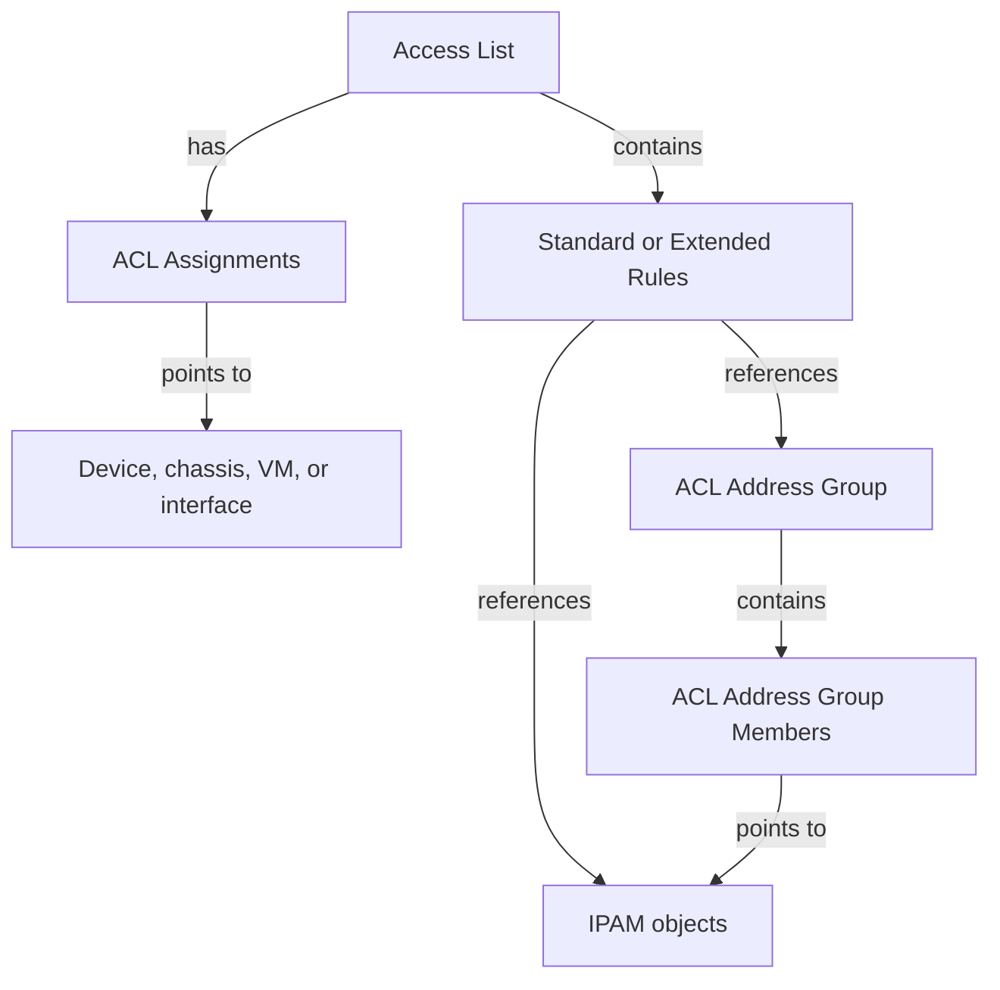

# Data model

The plugin has six concrete models. Access lists own rules and assignments.
Address groups own memberships. Rules and memberships reference existing
address objects.

The rule node represents two separate models. An access list's type determines
which one it uses. `ACLRule` is their abstract base. It has no separate list
view or API endpoint.

## Model map

| Model | Purpose |
|---|---|
| [AccessList](models/accesslist.md) | Named policy with type, family, and default action. |
| [ACLStandardRule](models/aclstandardrule.md) | Source criteria and action. |
| [ACLExtendedRule](models/aclextendedrule.md) | Source, destination, protocol, ports, ICMP type/code, and TCP flags. |
| [ACLAssignment](models/aclassignment.md) | An ACL's association with a supported target. |
| [ACLAddressGroup](models/acladdressgroup.md) | Reusable collection with one address family. |
| [ACLAddressGroupMember](models/acladdressgroupmember.md) | One IPAM object's membership in a group. |

## Shared metadata

All six models support owners, tags, custom fields, comments, and change
logging. Access lists, both rule types, and address groups also have a
description. Assignments and memberships have their own metadata, independent
of their parent and referenced object.

In REST, metadata fields include `id`, `url`, `display`, `created`, and
`last_updated`. These identify or describe a record. Supply writable fields
when creating or changing it. The model pages list user-managed fields.

See [Permissions](../administration/permissions.md) for separate grants on
parent and child objects, and [Address references](addressing.md) for generic
references and address-family rules.
